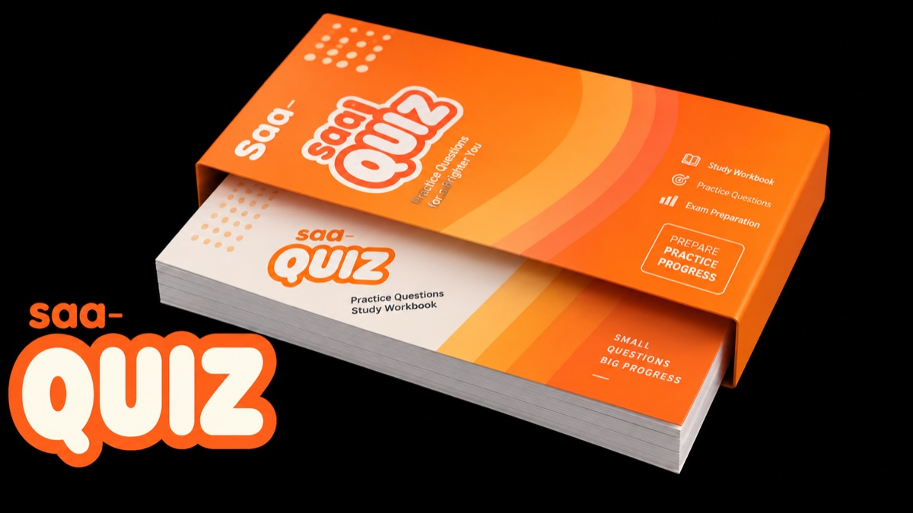

<p align="center"></p>

# saa-quiz

AWS Solutions Architect Associate(SAA-C03) 문제를 터미널에서 푸는 CLI입니다.
답과 함께 얼마나 확신하는지 고르고, 그에 따라 점수(XP)가 달라집니다.

## 설치

```bash
npm install -g saa-quiz
```

Node.js 20.12 이상이 필요합니다.

## 사용법

```bash
saa quiz   # 문제 풀기
saa xp     # 점수, 정답률, 오답노트 현황
```

처음 `saa quiz`를 실행하면 접근 코드를 묻습니다. 코드는 관리자에게 받으세요. 한 번 받고 나면 다시 묻지 않습니다.

새 버전이 나오면 명령이 끝날 때 알려 줍니다. 끄려면 `NO_UPDATE_NOTIFIER=1`을 지정하세요.

## 점수

| 확신도 | 맞으면 | 틀리면 |
|---|---|---|
| 확실 | +3 | −2 |
| 애매 | +2 | −1 |
| 자신 없음 | +1 | 0 |

- 같은 문제는 하루에 처음 푼 것만 점수에 들어갑니다.
- 복수 정답 문제는 정답을 모두 골라야 맞은 것으로 칩니다.
- `saa xp`의 합격선 72%는 실제 합격 점수 720/1000을 정답률로 어림한 값입니다.

## 오답노트

틀린 문제는 오답노트에 쌓이고, 다른 날 다시 맞히면 빠집니다.
`saa quiz`를 시작할 때 오답노트부터 풀지 고를 수 있습니다. 정리된 내용은 `~/saa-quiz/wrong-notes.md`에서 볼 수 있습니다.

## 데이터

풀이 기록은 `~/saa-quiz`에 md 파일로 저장됩니다. 다른 곳에 두려면 `SAA_DATA_DIR`을 지정하세요.
문제를 처음부터 다시 받으려면 `questions/` 폴더를 비우면 됩니다. 풀이 기록도 함께 지워집니다.

## 개발

```bash
npm install
npm run dev -- quiz
npm run typecheck && npm test
```

개발 규칙은 [AGENTS.md](AGENTS.md)에 있습니다.

## 라이선스

MIT
